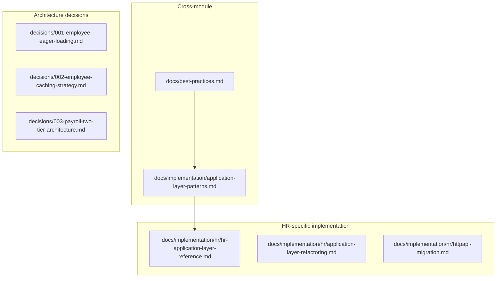

# Documentation Overhaul -- Stale Cleanup + ADRs + Cross-Module Patterns

## Problem

1. Most `implementation/` and `architecture/` files are one-time changelogs, not living docs.
2. Valuable decisions (eager loading, caching, payroll tiers) are buried in long files.
3. **[User feedback]** [application-layer-patterns.md](docs/implementation/hr/application-layer-patterns.md) mixes **cross-cutting** rules (canonical AppService, FluentValidation, AutoMapper, domain events) with **HR-only** content (employee service decomposition table). Patterns like thin HttpApi + validators in Contracts apply to **every** module; they should not live only under `hr/`.

## Target layout



```
docs/
  implementation/
    application-layer-patterns.md     # NEW location: all modules (see split below)
    README.md                         # lists cross-cutting + per-module folders
    hr/
      hr-application-layer-reference.md  # NEW: HR employee service table, HR ETO list, HRErrorCodes pointer
      application-layer-refactoring.md   # KEEP: HR refactor chronicle
      httpapi-migration.md               # KEEP: HR HttpApi migration log
      README.md                          # links only HR-specific files
    security/
      admin-bypass-permissions.md
  architecture/
    decisions/
      README.md
      001-employee-eager-loading.md
      002-employee-caching-strategy.md
      003-payroll-two-tier-architecture.md
  prd/hr/ ...
  modules/hr.md
```

---

## Phase A: Split application-layer patterns (before or with doc deletes)

### A1. Create [docs/implementation/application-layer-patterns.md](docs/implementation/application-layer-patterns.md)

Content policy:

- **Module-agnostic**: canonical AppService template using placeholders (`{Module}Permissions`, `{Module}MapperProfile`, `{Module}ErrorCodes` or "per-module error catalog in Domain.Shared").
- Sections: decomposition *principle* (one service per concern, when to split), `[RemoteService(false)]`, `[Authorize]` on public methods, programmatic IDOR checks, FluentValidation in Application.Contracts, `BusinessException` + codes, AutoMapper profile per module, domain events in Domain.Shared, thin HttpApi, contract mappers in HttpApi (align with [best-practices.md](docs/best-practices.md) section 5.1).
- **Single paragraph**: "HR is the reference implementation" with links to `hr/hr-application-layer-reference.md`, [modules/hr.md](docs/modules/hr.md), [prd/hr/README.md](docs/prd/hr/README.md).

### A2. Create [docs/implementation/hr/hr-application-layer-reference.md](docs/implementation/hr/hr-application-layer-reference.md)

Move from the current HR patterns doc:

- Employee focused services table (PersonalInfo, Document, Payroll, Search, etc.).
- HR-specific ETO table.
- Explicit pointer: `HRErrorCodes.cs` and error code ranges (`01xxxx` Employee, etc.).

### A3. Remove old file

- Delete [docs/implementation/hr/application-layer-patterns.md](docs/implementation/hr/application-layer-patterns.md) after content is split (avoid duplicate paths).

### A4. Update code and docs that pointed at the old path

| Location | Change |
|----------|--------|
| [src/ShikshaMitra.Application/HR/Employees/EmployeeAppService.cs](src/ShikshaMitra.Application/HR/Employees/EmployeeAppService.cs) | Obsolete message -> `docs/implementation/application-layer-patterns.md` |
| [src/ShikshaMitra.Application.Contracts/HR/Employees/IEmployeeAppService.cs](src/ShikshaMitra.Application.Contracts/HR/Employees/IEmployeeAppService.cs) | Same |
| [docs/implementation/hr/application-layer-refactoring.md](docs/implementation/hr/application-layer-refactoring.md) | Link to new global patterns file + HR reference |
| [docs/README.md](docs/README.md) | Row: "Application layer patterns" -> `implementation/application-layer-patterns.md` |
| [docs/prd/hr/README.md](docs/prd/hr/README.md) | Link global patterns + HR reference |
| [docs/best-practices.md](docs/best-practices.md) | Add one line under relevant section: canonical template lives in `implementation/application-layer-patterns.md` |
| [AGENTS.md](AGENTS.md) | Task routing: "Application layer patterns (all modules)" -> `docs/implementation/application-layer-patterns.md`; HR-specific -> `docs/implementation/hr/` |

---

## Phase B: Create ADRs

Same as prior plan: extract concise ADRs from:

- [docs/implementation/employee/Employee-EagerLoading-Implementation.md](docs/implementation/employee/Employee-EagerLoading-Implementation.md) -> `architecture/decisions/001-employee-eager-loading.md`
- [docs/implementation/employee/Employee-Caching-Implementation.md](docs/implementation/employee/Employee-Caching-Implementation.md) -> `002-employee-caching-strategy.md`
- [docs/architecture/payroll/PAYROLL-ARCHITECTURE.md](docs/architecture/payroll/PAYROLL-ARCHITECTURE.md) -> `003-payroll-two-tier-architecture.md`

Template: Status, Context, Decision, Consequences, Key details.

---

## Phase C: Delete stale files (24 files)

Unchanged from prior plan -- delete entire directories:

- `docs/implementation/hr/earning-components/` (4)
- `docs/implementation/hr/deduction-components/` (2)
- `docs/implementation/hr/pagination/` (4)
- `docs/implementation/hr/permissions/` (3)
- `docs/implementation/hr/leave-management/` (2)
- `docs/implementation/employee/` (4) -- after ADR extraction
- `docs/architecture/employee/` (3)
- `docs/architecture/payroll/` (1) -- after ADR-003 written
- `docs/improvements/` (1)

**Note:** Phase A deletes `hr/application-layer-patterns.md` as part of the split; Phase C must not assume that file still exists.

---

## Phase D: Update remaining indexes

- [docs/implementation/hr/README.md](docs/implementation/hr/README.md): `hr-application-layer-reference.md`, `application-layer-refactoring.md`, `httpapi-migration.md`
- [docs/implementation/README.md](docs/implementation/README.md): lead with `application-layer-patterns.md`, then `hr/`, `security/`
- [docs/README.md](docs/README.md): documentation map -- ADR index + updated pattern links
- [docs/architecture/employee/README.md](docs/architecture/employee/README.md): **removed with directory** -- no orphan architecture/employee folder

---

## Execution order

1. **Phase A** (split patterns) -- so Obsolete attributes and indexes never point at a deleted mid-move path for long.
2. **Phase B** (ADRs) -- while source files in `employee/` and `payroll/` still exist.
3. **Phase C** (bulk delete).
4. **Phase D** (final index polish).

---

## Metrics (revised)

| Action | Count |
|--------|-------|
| New files | 5 (global patterns + HR reference + 3 ADRs + decisions/README) |
| Deleted files | ~25 (includes old `hr/application-layer-patterns.md`) |
| Moved/split | 1 file becomes 2 |
| Code files touched | 2 (Obsolete doc paths) |

---

## Rationale (for reviewers)

Keeping **generic** patterns under `docs/implementation/` matches how [best-practices.md](docs/best-practices.md) already states it applies to **all modules**. HR remains the first module that fully applied these patterns; the HR folder keeps the **chronicle** (refactoring, HttpApi migration) and the **lookup table** (which employee AppService does what), not the canonical template for every future module.
