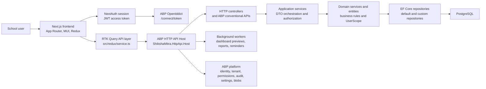
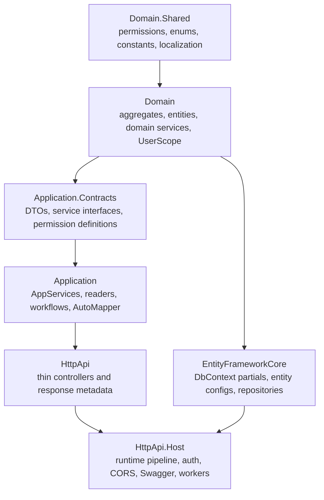
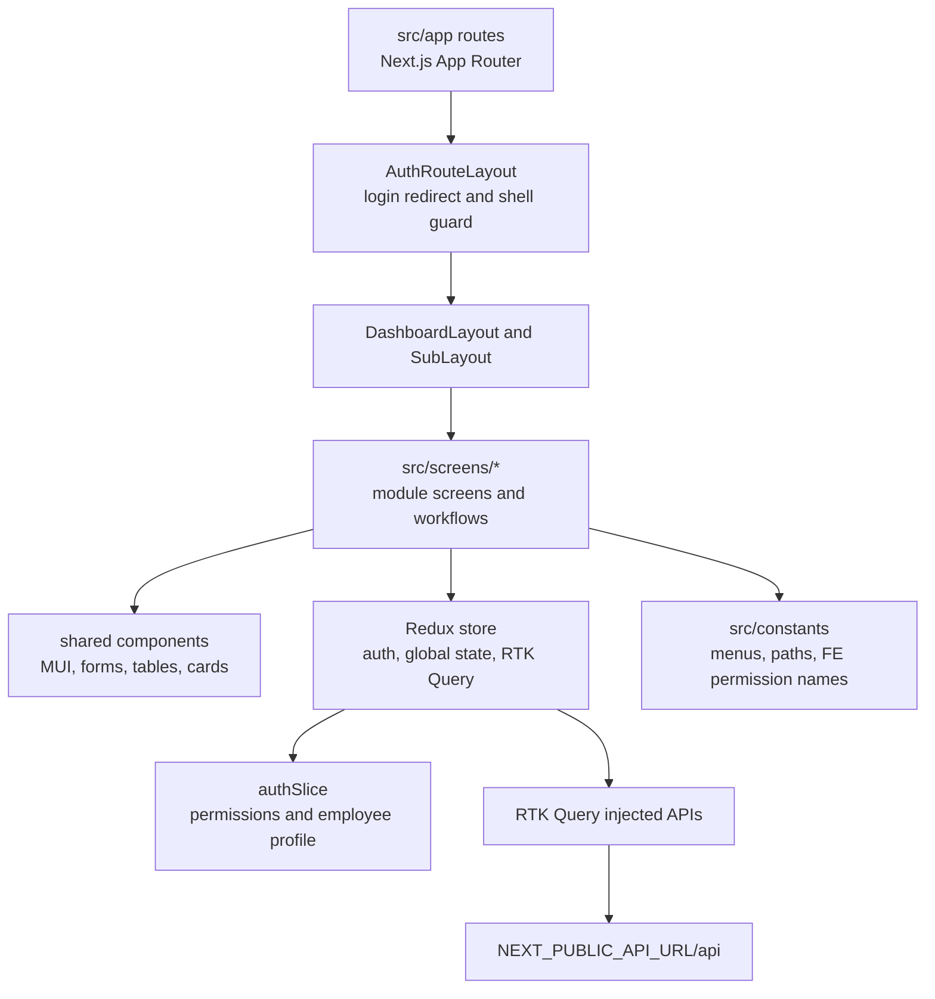
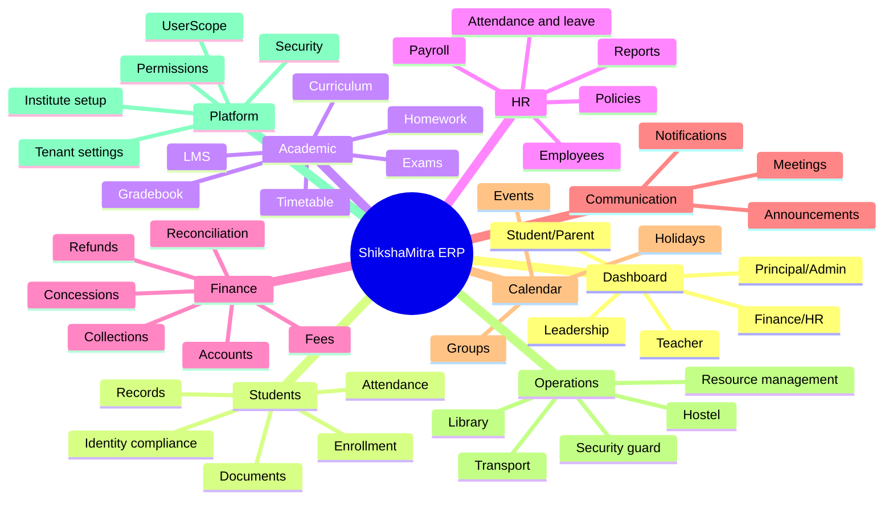
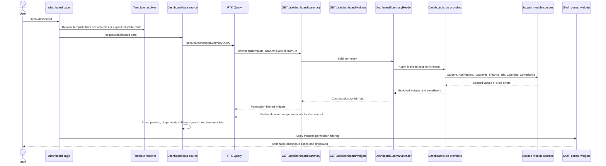
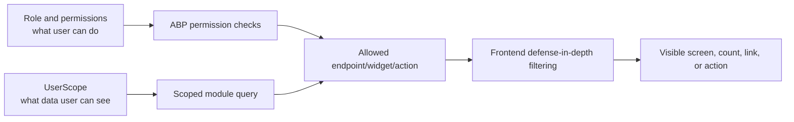

# ShikshaMitra ERP Architecture

This document is the canonical high-level architecture overview for ShikshaMitra ERP. It explains how the current system is implemented across the Next.js frontend, ABP/.NET backend, PostgreSQL persistence, and cross-cutting platform services.

## Runtime System

The application is a modular monolith. Modules are separated by folder, project layer, contracts, permissions, and aggregate boundaries, not by independently deployed services.

## Backend Layers

The backend follows the ABP DDD layer rules in [project best practices](../best-practices.md). Important runtime responsibilities are:

| Concern | Current owner |
| --- | --- |
| Authentication and token validation | OpenIddict and ABP auth in `HttpApi.Host` |
| Tenant isolation | ABP multi-tenancy filters and tenant middleware |
| Authorization | `[Authorize]`, ABP permission checks, and module permission definitions |
| Data scope | `UserScope` services and `IUserScopedEntity` filtering |
| Persistence | EF Core with PostgreSQL, partial DbContext files, and custom repositories |
| Auditing | ABP audit logging plus module audit tables where needed |
| Files and generated artifacts | ABP BlobStoring database provider and module file services |
| Background processing | ABP background workers and jobs in the host |

## Frontend Layers

The frontend is route-first and module-screen oriented. Authenticated routes render through the shared authenticated layout, then each module screen uses local UI components, Redux state, RTK Query endpoints, and menu/permission constants.

## ERP Module Map

## Dashboard Command Center

`/dashboard` is implemented as a role-template command center. The current templates are `leadership`, `principalAdmin`, `teacher`, `financeHr`, and `studentParent`. The frontend resolves the template, the backend returns the summary contract, and both layers filter widgets by permissions.

Live dashboard areas currently include scoped student records, scoped student attendance, selected action queue counts, Finance/HR snapshots, Academic curriculum/exam/result signals, Calendar item enrichment, local student identity compliance readiness, limited Teacher assigned-class/workload/exam/result signals, and limited Student/Parent personal attendance, assignment, fee, document, and result signals through exact single-student email resolution. Communication announcements, Transport/Security exception counts, broad Teacher workload, Student/Parent transport/safety values, and official external compliance portal status remain readiness or drilldown oriented until their owning modules expose scoped sources.

`DashboardSummaryReader` also records slice-level operational signals: elapsed time is logged at debug level, new `zoneErrors` are logged at warning level, and unexpected slice exceptions are logged at error level before they propagate.

`GET /api/dashboard/widgets` exposes the backend-owned dashboard widget catalog. It is protected by the Dashboard permission and returns registered widget IDs, zones, drilldown URLs, owners, and required permissions so future frontend registry generation or runtime adoption can move away from duplicated metadata.

Supporting dashboard docs live in the frontend repo:

- [Dashboard PRD](../../../Shikshamitra-FE/docs/dashboard/prd.md)
- [Dashboard data contract](../../../Shikshamitra-FE/docs/dashboard/data-contract.md)
- [Dashboard testing and acceptance](../../../Shikshamitra-FE/docs/dashboard/testing-and-acceptance.md)

## Security And Scope Model

Security is layered:

- Backend endpoint access is enforced with ABP authorization attributes and permission checks.
- Backend data summaries must apply UserScope before counts, lists, alerts, or drilldowns are returned.
- Frontend permission filtering is defense in depth and must not be treated as the primary security control.
- Tenant isolation is handled by ABP multi-tenancy and must not be bypassed with manual cross-tenant queries.

## Documentation Boundaries

- Cross-cutting architecture docs live under `docs/architecture`.
- Cross-cutting platform docs live under `docs/common`.
- Module-owned docs live under `docs/modules/<module>`.
- Frontend-specific dashboard product and testing docs remain in `Shikshamitra-FE/docs/dashboard`.
- Significant architecture choices are recorded as ADRs under [decisions](decisions/README.md).
