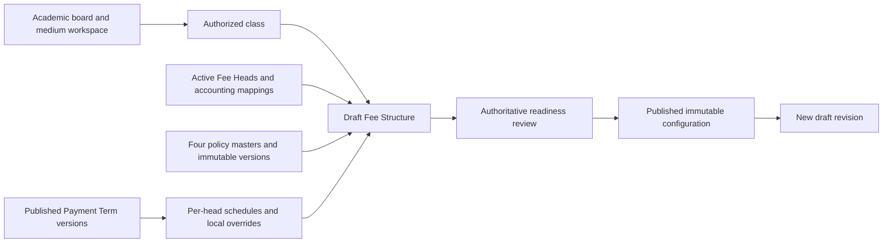

# Fee Structure configuration and publication

This implementation manages Fee Structure configuration only. Creating, saving, previewing, publishing, or revising a structure creates no student assignment, demand, payment, or refund. Student assignment now also accepts structures without a concession attachment. Existing concession request resolution remains unchanged.

## Ownership and lifecycle



| Object | Responsibility |
|---|---|
| Metadata | Academic year + board + medium parent workspace; exposes only accessible child classes |
| Structure | Named class configuration and revision lineage; owns exact policy attachments |
| Structure detail | Unique Fee Head, total service-coverage amount, one-time/optional flags, exact Payment Term version, schedule mode |
| Schedule override | Structure-local dates and percentages referencing an installment in the pinned Payment Term version |
| Policy attachment | One exact immutable version per family; monetary applicability is resolved per matching structure Fee Head |
| Publication review | Saved coverage, exact configuration, policy labels and resolved schedule in aggregate `ExtraProperties.PublicationReview` |

Drafts may be incomplete. New/changed attachments must be valid: wrong-year, inactive, foreign-version, duplicate-head, corrupt-snapshot, and invalid-custom-schedule errors block relationship changes. Name/amount-only PATCH operations validate the command and monetary shape without revalidating unrelated master settings; full preview/publication always revalidates everything. `SaveAsDraft=false` requests complete validation on a save; publication remains a separate explicit action.

Publication requires at least one active Fee Head, an active valid accounting mapping for every head, a Collection policy, and a published/superseded version of an active Payment Term for every head. Refund and Proration are optional. A structure without Proration uses full-charge coverage labels; no Refund attachment means no refund policy has been configured by this workspace.

Concession Policy setup has been removed from the Fee Structure UI. New structures can be published and assigned without an attachment; no default concession is selected and no discount is granted. Existing attachment/version/scope fields remain for compatibility and historical request processing; supplied legacy attachments still receive their existing validation. The request flow has not moved to request-level policy selection: a new assignment without a snapshot cannot create a concession request, and its legacy concession-context read returns `PolicyNotAttached`. Existing snapshots are preserved. No database migration or historical rewrite is required.

## Policy and Fee Head mismatch rules

Policies attach to the **Fee Structure**; the policy's head rules apply to the **intersection with the structure's Fee Heads**. Policy-only heads never add fees automatically.

| Situation | Behavior |
|---|---|
| Collection policy contains additional heads | Allowed; warn about unused heads |
| No Collection late-fee heads overlap | Allowed with an explicit no-late-fee warning; structure-level collection controls remain attached |
| Structure head absent from Collection late-fee scope | No late fee for that head |
| Concession scope is all structure heads | Resolve and store all concession-enabled structure head IDs |
| Concession scope is selected heads | Every selected ID must be present in the structure and concession-enabled; empty selection is invalid |
| No concession-enabled heads at publication | Allowed when no legacy concession policy is attached; an existing attachment still requires compatible coverage |
| Refund selected-head policy has no intersection | Warn in an incomplete draft; block publication until matching heads are added or the attachment is changed/cleared |
| Proration policy does not mention a structure head | Full charge; warn in review |
| One-time structure head has a recurring Proration rule | Reject the conflicting configuration |
| Extra policy heads are added later to a draft | Recompute coverage on preview, save and publication |
| A selected concession head is removed | Selected scope becomes invalid; require explicit correction |
| Master or snapshot is unavailable/inactive/wrong-year | Reject new or changed draft use; published review remains readable |

No silent substitution of IDs, head-name matching, auto-addition of heads, or automatic adoption of newer versions occurs. An explicitly supplied policy version must belong to the selected active policy in the same academic year. For compatibility, an omitted version retains the exact existing version when the policy ID is unchanged; a newly selected policy without a version resolves its latest active immutable snapshot.

## Payment Terms and installments

Each head selects its own exact term/version. This supports tuition in two terms, annual one-time admission fees, and a different transport schedule within one structure. There is no implicit structure-wide term fallback.

- Term year and board must match the class workspace. Draft/archived versions and archived masters are rejected for draft configuration/publication.
- New selections require the current published version. Unchanged superseded pins are retained; a newer version never replaces an existing pin during an unrelated edit.
- Amount is the **total for the selected term's service coverage**, not a monthly amount multiplied automatically. Existing termless legacy rows must have their amount interpretation reviewed before a term is selected.
- `Inherited` requires no overrides. `Customized` requires overrides referencing the selected version's installment IDs, names and sequence numbers. Partial override rows are merged with that exact master schedule.
- The merged schedule, not just the changed rows, must have valid coverage dates, increasing due dates, no overlapping coverage periods and allocations totaling exactly 100%.
- The existing Payment Term validator enforces the board window and demand-date rules. Derived demand dates are recalculated from changed coverage/due dates; only `SpecificDate` uses an explicit demand-date override.
- One-time means a single service charge; that charge can still be paid in multiple installments.
- The existing resolver allocates rounded amounts and absorbs the residual in the final installment. Negative resolved amounts and invalid totals block the structure.
- Publication review shows the resolved template calendar. Execution-time holiday handling, reminder dispatch and demand scheduling belong to the existing Payment Term/demand workflow; this change does not implement those jobs.

Amounts are nonnegative, have at most two decimal places and are capped at 9,999,999,999.99 per head to stay within a practical browser-safe monetary range. A draft supports up to 500 heads. Zero-value heads are allowed; readiness checks still apply.

## Versions, edits and historical protection

| Operation | Rule |
|---|---|
| Create | New root with `RevisionRootId=Id`, `RevisionNumber=1`; optional client `RequestId` makes an identical create retry return the original result |
| Update | Add permission, exact tenant/class scope, matching `ConcurrencyStamp`, unlocked and unused structure; retained heads preserve detail IDs |
| Delete | Delete permission; unlocked and unused draft only; soft deletion preserves reserved revision numbers |
| Publish | Add permission, matching stamp, fresh full server validation; capture review then lock in the same unit of work |
| Retry publish | Already-published structure returns its canonical record without another publication |
| Revise | Add permission, checked published source and stamp; copy exact pins and overrides into a separate draft with new detail IDs |
| Retry revision | Return the existing live draft in the lineage |
| Revise historical version | Once a newer publication exists, start the next revision from that publication; prevent divergent new branches |
| Revision name | Retain the series name from the published parent; edit fee configuration in the draft |
| Legacy unlocked but used | Reject update, delete and publication; do not rewrite data already referenced by student fees |
| Legacy published row | Remains protected; does not gain an invented historical review. Its first new revision must meet current publication rules |

Policy versions, schedule pins and local overrides are copied as data. Revision creation deliberately reads history without EF tracking to avoid changing the published parent's concurrency stamp through relationship fixup. Live parent names cannot collide within a class; a filtered unique normalized-name index is the final race guard. A unique `(RevisionRootId, RevisionNumber)` index prevents duplicate revision numbers even under concurrent requests.

## API and permissions

All routes require authentication and exact tenant/class scope. Application services also enforce action permissions; controller guards alone are insufficient.

Academic workspace, scope and calendar lookups project only the required fields. They must not materialize the academic hierarchy's recursive automatic includes: doing so can make even a small workspace list time out. Configured-class counts use distinct class IDs with at least one configured head, restricted to the user's accessible classes.

| Route | Permission | Contract |
|---|---|---|
| `GET /api/fee-structures-metadata` | `Finance.Settings.FeeStructure.View` | Year, page, pageSize 1-100, search; filtered counts and accessible `classes` |
| `POST /api/fee-structures-metadata/generate` | `.Add` | Prepare missing accessible board/medium workspaces; no fee amounts generated |
| `GET /api/fee-structures?standardId=...` | `.View` | Canonical versions with complete overrides and concurrency stamps |
| `GET /api/fee-structures/context` | `.View` | Class/metadata IDs; no reference catalogs |
| `GET /api/fee-structures/settings` (compatibility) | `.View` | Metadata + standard IDs; scoped heads, policy snapshots, term versions and action permissions; receipt list retained empty for compatibility |
| `POST /api/fee-structures/preview` | `.View` | Candidate + metadata/standard + optional structure ID; errors, warnings, coverage and resolved schedule |
| `POST /api/fee-structures?feeStructureMetadataId=...` | `.Add` | Standard ID, optional RequestId UUID, `standardFeeStructures` candidate |
| `PATCH /api/fee-structures/{id}` | `.Add` | Request ID, concurrency stamp and explicit `changes` object |
| `PUT /api/fee-structures/{id}` | `.Add` | Complete candidate with concurrency stamp |
| `POST /api/fee-structures/{id}/publish` | `.Add` | `concurrencyStamp` |
| `POST /api/fee-structures/{id}/revisions` | `.Add` and `.Add` | Source `concurrencyStamp` |
| `DELETE /api/fee-structures/{id}` | `.Delete` | Unused draft only |
| `PATCH /api/fee-structures/{id}/lock` | `.Add` | Retired compatibility route: rejects with instructions to review and use stamped publication |

Permission prefix in abbreviated rows is `Finance.Settings.FeeStructure`. Changed attachments additionally require `Finance.Policies.{CollectionPolicy|ConcessionPolicy|ProrationPolicy|RefundPolicy}.Add`; changing selected concession coverage is an attachment change. Existing unchanged attachments do not require every policy-management permission merely to edit a fee amount.

The `Finance:FeeStructure:*` error family includes InvalidConfiguration, ScopeMismatch, VersionMismatch, ConcurrencyConflict, DuplicateName and RevisionRequiresPublication. Validation failures include human-readable `error.data.Errors`; clients should retain unsaved input and display this list. Database uniqueness/concurrency failures must not be interpreted as a successful save; refresh the canonical resource before retrying.

## Migration and rollout

`20260909160000_AddFeeStructureRevisions` adds the lineage, Receipt Book and normalized-name columns, backfills each existing structure as its own v1 root, and adds unique/restrict constraints. It does not change legacy `IsLocked`, policy pins, amounts, assignments or transactions. Publication reviews use the aggregate's existing ExtraProperties storage.

Before applying to a target PostgreSQL database, inspect duplicate live names and overlong names:

```sql
SELECT "StandardId", upper(trim("Name")) AS normalized_name, count(*)
FROM "Finance_FeeStructures"
WHERE NOT "IsDeleted"
GROUP BY "StandardId", upper(trim("Name"))
HAVING count(*) > 1;

SELECT "Id", "Name" FROM "Finance_FeeStructures" WHERE length("Name") > 256;
```

Resolve any results through a reviewed data repair before migration; the unique index deliberately fails instead of renaming or deleting historical records. Apply migration and backend before the matching frontend. Grant the new Publish permission to authorized roles explicitly. Review existing termless structures and missing settings through new drafts. No migration has been applied by this implementation task.

Do not use the migration's Down path as an operational rollback after revisions exist: it removes lineage and Receipt Book metadata. Prefer a forward repair or a validated full backup restore.

## Source and verification

- Application: `src/ShikshaMitra.Application/Finance/Fees/Settings/FeeStructureAppService*.cs`, `FeeStructureMetadataAppService.cs`.
- Contracts: `src/ShikshaMitra.Application.Contracts/Finance/Fees/Settings/FeeStructures/`.
- Domain and EF configuration: `Finance/Fees/Settings/FeeStructures/` in their owning projects.
- Focused application tests: `FeeStructureAppService_CollectionPolicy_Tests`, its workspace partial, `FeeStructureSchema_Tests`, and `PaymentTermInstallmentValidator_Tests`.
- Frontend flow and browser fixture: [frontend implementation notes](../../../../../Shikshamitra-FE/docs/finance/references/fee-structure-workspace.md).

```powershell
dotnet test test/ShikshaMitra.Application.Tests/ShikshaMitra.Application.Tests.csproj --filter "FullyQualifiedName~FeeStructureAppService_CollectionPolicy_Tests|FullyQualifiedName~FeeStructureSchema_Tests|FullyQualifiedName~PaymentTermInstallmentValidator_Tests"
dotnet build src/ShikshaMitra.HttpApi/ShikshaMitra.HttpApi.csproj
dotnet test test/ShikshaMitra.HttpApi.Tests/ShikshaMitra.HttpApi.Tests.csproj --filter "FullyQualifiedName~FeeStructureApi_Tests"
```

## Implementation verification record

On 2026-09-09, the final focused application run passed 23 tests covering the structure workspace and schema, and the HTTP run passed all three Fee Structure API tests. HTTP tests use the in-memory SQLite test host and select the academic workspace matching the seeded class's board/medium. The HTTP build used an isolated output folder because an existing backend process held the normal host build files. Backend documentation validation passed for all modules.

The API checks cover settings retrieval, request-body binding, incomplete-publication rejection, and one-time/recurring payable-field round trips. Application tests cover the broader lifecycle, pinned versions, overrides, policy coverage, concurrency, tenant/class scope and migration-model parity. These checks do not constitute a PostgreSQL migration execution or a signed-in browser test against a deployed backend; both remain rollout checks.


## Individual lookups and partial updates (2026-09-10)

The active frontend no longer calls the combined `/api/fee-structures/settings` catalog. That endpoint and PUT remain compatibility surfaces. New GET `/api/fee-structures/context` returns only academic IDs/names/calendar and action/read permissions, after checking the class against metadata and current user scope.

Each owning policy list/detail now exposes `currentVersionId`, `currentVersionNumber` and `isAttachable`. A current ID must match the active master's exact version number, academic year and active immutable snapshot. Missing snapshots are not replaced with arbitrary history. GET lists continue to return one row per master. Payment Term lists expose `publishedVersionId` and `publishedVersionNumber`; `currentVersionNumber` alone may describe an unpublished working draft and is unsuitable for attachment.

New draft policy defaults are a frontend initialization choice: select a single eligible current default once per family, after all lookup pages finish. Never initialize saved records or overwrite a clear/manual selection. No default means no attachment; ambiguous defaults require explicit selection. Backend commands still validate the supplied IDs and versions. Defaults do not create any server row until Save.

Receipt Book no longer participates in candidate application, catalogs or publication validation. Legacy request/response fields and the stored column remain for compatibility; old request values are ignored. Existing historical values/publication snapshots are retained. This refactor adds no destructive migration and changes no receipt numbering or collection behavior.

### PATCH contract

```json
{
  "requestId": "client-generated-uuid",
  "concurrencyStamp": "last-server-stamp",
  "changes": {
    "name": "Annual fees",
    "policies": { "refund": null },
    "feeHeads": {
      "update": [{ "lineId": "saved-line-uuid", "amount": 1250.25 }]
    }
  }
}
```

- Omitted fields/lines are unchanged; a null family explicitly clears its ID/version pair. Concession clear also resets its selected scope.
- A non-null family selection supplies both non-null policy ID and immutable version ID. Concession additionally accepts `feeHeadScope` and `applicableFeeHeadIds`.
- `feeHeads` supports `add`, `update`, `removeLineIds`. Existing line identity cannot be changed. Reject foreign IDs, unknown fields, duplicate/conflicting operations, invalid numeric precision and duplicate heads.
- A schedule update supplies `paymentTermId`, `paymentTermVersionId`, `scheduleMode`, and `installmentOverrides` together. Omitted schedules and unchanged override rows preserve their identities.
- Matching no-op commands return the canonical record without writing. A successful mutation advances the stamp and records the request hash in `ExtraProperties.PatchRequests` atomically.
- Retrying the same key/body returns the **current canonical record** without reapplying the old change, even if another successful edit followed. Reusing the key with a different body conflicts. The client keeps a key stable for a failed identical command; a changed command uses a new key and the last acknowledged stamp.
- Name/amount-only commands avoid full setting validation. Relationship changes validate the merged configuration; review/publication validate all dependencies again. Changed attachments require their family Add permission.
- Published or used structures reject new edits. Prior successful retries are read-only. Published configuration is changed through a separate revision.

Family/year/ID cache tags isolate policy refreshes. An existing structure PATCH replaces the owning class's cached record from the canonical response; it does not refetch any policy/head/term catalog. Create/revision/delete still refresh class/count projections as necessary.


## Verification update - 2026-09-10

All 32 focused application/schema cases are covered by passing results: 31 passed in the final full run, and the context case passed after correcting its test to inspect top-level JSON properties (the previous substring assertion incorrectly matched the `termsRead` permission). The context correction changed test code only. The three HTTP cases passed, including context retrieval, PATCH body binding and publication rejection for an incomplete draft.

The added cases cover exact current policy identity, stale new selection rejection, unchanged historical pins, amount-only updates, customized override row identity, preserved legacy receipt storage, explicit clears, no-op behavior, stale stamps, duplicate request keys and retries after subsequent edits, and malformed/foreign operations. All backend module documentation checks pass. Tests did not execute a PostgreSQL migration or operate on the user's live financial records.


Configuration actions use the [three-permission contract](../api.md#fee-configuration-permissions). View reads/reviews, Add creates/edits/publishes/revises, and Delete removes unused drafts.
