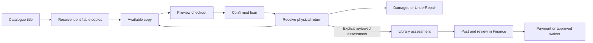

# Operate Library workflows

TL;DR: configure the school's catalogue and borrowing rules, receive stable physical copies, then preview and confirm borrowing, returns and reservations against current authorized records.
Physical stock movements, Library assessments and Finance settlements retain separate evidence.
The flows below describe backend behavior; available screens and client behavior belong to the [frontend Library workflows](https://github.com/gyanmirai/Shikshamitra-FE/blob/main/docs/library/workflows.md).

## Configure a school's catalogue

1. An active school operator with dedicated configuration View reads effective rules. No override returns Defaults.
2. A tenant-wide manager with both dedicated View and Update changes requirements or adds/retires choices.
3. Save with the exact revision. Concurrent administrator edits produce one successful change and a 409 for the stale request.
4. Editors load rules through `books/editor-options` with catalogue actions and an authorized academic year.
5. Create/update carries the reviewed revision and explicit language/material values. The backend validates before saving.
6. Catalogue, circulation and report readers resolve current labels; existing descriptions and stock/loan/receiving history remain unchanged.

For an anonymous Bengali donation, make Author optional, add `bn`, save configuration, then create the title with Author=null, Language=null and LanguageCode=`bn`.
An existing Gujarati title keeps numeric Language=0; no migration to a custom code is required.
Leave both price fields null when the donation's catalogue price is Unknown. An existing known zero stays `0.00`.
For a known price, send exact `priceText` and a null numeric `price`; catalogue price does not populate receiving cost or Finance charges.
Frontend freezing, conflict review, route guards and cache behavior belong to the [frontend Library workflows](https://github.com/gyanmirai/Shikshamitra-FE/blob/main/docs/library/workflows.md).

## Configure borrowing without imposing one school model

1. Choose the actual school academic context and policy targets, such as borrower role, stage, standard, category or section.
2. Save a draft with explicit limits, due-date mode, renewal and reservation terms.
3. For Automatic due dates, configure the Library timezone, opening weekdays and applicable closures before publication.
4. For Manual due dates, staff supply the reviewed deadline during checkout; automatic duration fields may be zero.
5. Publish with the current concurrency token after reviewing the target and effective dates.
6. New checkouts resolve effective terms and save their policy and calendar evidence on the loan.
7. Later policy edits do not replace the original loan's saved terms.

| School example | Explicit setup | Operational effect |
|---|---|---|
| Small primary school using a paper register | Manual deadlines and the school's real borrowing limits | Staff enter the agreed return date; no automatic calendar duration is invented |
| Secondary school using weekly lending | Automatic duration, chosen day-count mode and actual closures | The preview calculates a deadline from the school's configured calendar |
| School with different student and staff rules | Separate targeted policy versions | Each checkout resolves the applicable version rather than assuming one common quota |

The actual rules are in `src/ShikshaMitra.Domain/Library/Policies/ValueObjects/LibraryBorrowingTerms.cs`.
Publication and calendar readiness are enforced in `src/ShikshaMitra.Application/Library/Policies/LibraryBorrowingPolicyAppService.Lifecycle.cs`.

## Receive purchases, donations and existing stock

1. Create or select the persistent catalogue title; catalogue price may be Unknown.
2. Enter the actual receipt source, received-on school date, source/reference and title quantities.
3. Select valid physical locations and either supply reviewed accessions or use server allocation.
4. Enter acquisition cost only when known; it is independent of catalogue price and replacement assessments.
5. Preview the receipt and review validation errors, resulting copies and revision.
6. Submit that reviewed revision with a stable idempotency key.
7. The backend revalidates under the school inventory fence, creates new stable copies and retains immutable receipt, line, copy-link and accepted-command evidence.
8. Retrying the same accepted command returns the saved receipt; reusing its key with different content is rejected.

For example, a donation of three anonymous picture books can retain Unknown catalogue price and Unknown acquisition cost.
Receiving creates three separately identifiable copies; it does not create a purchase expense or a borrower payment.
Existing copies and their loans are not replaced by receiving more copies of the same title.
The transaction is implemented in `src/ShikshaMitra.Application/Library/Receiving/LibraryReceivingAppService.Receive.cs`.

## Import catalogue titles and copies from CSV

1. In Stock Receiving, open Stock Imports and select an academic year, section, shelf, receipt source and default school date. Select a category when the file adds titles.
2. Upload a UTF-8 CSV with one row per physical copy. Supply an existing `BookId`, or group new copies using one `TitleKey` and the same catalogue details on every row in that group. Use the school's active language and material codes wherever required.
3. Give each copy a stable source row ID. Keep IDs and accessions in text columns so spreadsheet editors preserve leading zeroes. Map old headers such as `Register No.` to `SourceRowId`.
4. Preview every action and fix listed lines. A ready preview permits the whole batch to be committed together. A failed, incomplete or stale batch adds no copies.
5. After acceptance, use the batch history to find each copy's accession and recorded receipt. Retry the unchanged command after an uncertain response. Keep the original source IDs when preparing a changed file so the next preview can identify already imported rows.

A primary school can import two donated copies under `folk-stories` with distinct source IDs and accessions `000031` and `000032`. If the donor supplied no values, leave both catalogue price and acquisition cost blank. A secondary school topping up existing exam readers can supply each title's `BookId` and a confirmed unit cost such as `85.50` with `INR`. A school digitizing an old register can use Opening stock, preserve existing barcodes, and leave blank accessions for server allocation.

## Open a stock count and record scans

Choose a section, an optional shelf, or the whole school when the current scope permits it. Preview the expected copies and their recorded statuses for the school date. Open the count with that revision. The server saves the original copy IDs, accessions, statuses, and locations under the inventory lock.

Scan a barcode or type an accession. Record the observed location when available. Each accepted scan has its own sequence, including unknown accessions and repeat sightings. Use the same request after a timeout to recover the accepted result. The baseline and scan history remain separate from the live copy register.

Open reconciliation to compare the latest observation for each expected copy with the current register. For example, a copy with a confirmed open loan appears On loan, a copy under repair appears In repair, and an available copy with no scan appears Not seen. A legacy accession match without a confirmed copy link appears as conflicting register evidence. Inspect recognized scans outside the baseline and unknown scans in their own views. Reading this comparison has no effect on circulation, copy conditions, or charges.

Start review after confirming the recorded scan count. This seals scanning while keeping the live reconciliation visible. If a scan arrives after confirmation, review the latest count before confirming again. Cancel a count from Counting or In Review with a recorded reason. The baseline and scan log remain readable after cancellation.

While In Review, record how each flagged finding will be handled and give a reason. For example, select Follow up for an available copy that staff plan to look for on the returns trolley. The reason becomes part of the count history. If the register or another reviewer's decision changes, check the latest finding before saving a new decision. The work of correcting the copy register keeps its own permissions and workflow.

An authorized approver reviews the approval summary and completes the count when every flagged finding has a current decision. A section count uses its recorded academic year to evaluate current register evidence during review, even for staff with whole-school access. If a copy moves outside that year, its current register details are unavailable to the count. The published result preserves the approved status, location labels, and cited decision versions when the school moves, repairs, or lends copies later.

For example, a librarian records a donation while a count is open and later scans one of its copies. If the scan is outside the baseline, the finding retains the verified receipt timing. Other outside-baseline scans keep their original finding when there is no matching receipt evidence.

## Edit a catalogue title or its copies

Read the title detail and retain the independent metadata and copy revisions with their corresponding drafts.
Metadata-only updates send the reviewed metadata revision.
A complete copy-list update sends its reviewed copy revision; a combined update protects both concerns.
On conflict, review the new server state and reconcile the draft explicitly before making another submission.
An acknowledgement for metadata must not refresh the revision of an older unsaved copy list.

Removing a copy is subject to retained operational and receiving history.
Whole-title deletion uses its own Delete permission and the detail's current `canDelete` and `deletionBlockedReason` decision.
The command checks retention again under the inventory fence, because another operator may have received stock or recorded activity after the detail was read.

Catalogue and copy source entry points are:

1. Inspect `src/ShikshaMitra.HttpApi/Controllers/Library/BookController.cs`.
2. Inspect DTOs under `src/ShikshaMitra.Application.Contracts/Library/Books/**`.
3. Inspect `src/ShikshaMitra.Application/Library/Books/BookAppService.cs`.
4. Inspect entities under `src/ShikshaMitra.Domain/Library/Books/**`.
5. Inspect mappings under `src/ShikshaMitra.EntityFrameworkCore/Library/Books/**`.

## Check out a physical copy

1. Resolve the actual borrower identifier and canonical person, then select the authorized academic context.
2. Resolve a stable copy or accession; review its physical status and any open loan or allocated hold.
3. Preview checkout using the explicit school issue date and, for Manual mode, the requested due date.
4. Review eligibility, active-loan count, quota, applicable terms, calendar and calculated deadline.
5. Submit the exact preview revision with a stable idempotency key.
6. Under the inventory fence, the backend recalculates the plan and refuses stale or no-longer-eligible checkout.
7. An accepted command saves the loan's copy identity, borrower context, policy/calendar evidence and actor, changes the copy to Issued, and records loan/copy events.
8. Relevant reservation transitions and notification work use that accepted operation.

Two operators cannot use older previews to issue the same physical copy twice.
If the response is lost, retry the same command and key; do not create a new checkout intent merely because the client did not receive the response.
An inactive borrower may still have recoverable historical obligations, but that does not grant eligibility for new borrowing.

The canonical controller is `src/ShikshaMitra.HttpApi/Controllers/Library/LibraryLoanController.cs`.
Checkout orchestration is in `src/ShikshaMitra.Application/Library/Circulation/LibraryLoanAppService.Checkout.cs`.

## Renew an existing loan

1. Read the authorized exact loan, its current school context and saved terms; choose an actual authorized year and explicit school renewal date for the preview.
2. Review saved borrowing terms, renewal limits, blockers and the proposed new due date.
3. If the current calendar differs from the saved evidence, supply the required explanation before applying the current calculation.
4. Submit the exact preview revision and stable idempotency key.
5. The accepted renewal changes the current due date and records the previous state, calculation and reason in a renewal event.

The original loan and its saved policy are retained.
Backend renewal support does not by itself establish that every active frontend loan table exposes a renewal action.
See `src/ShikshaMitra.Application/Library/Circulation/LibraryLoanAppService.Renew.cs` and the frontend workflow documentation for the current screen wiring.

## Review uncertain historical loan dates

1. Read the exact saved loan under View and recorded-row scope.
2. Check `canReviewDates`; it requires the current ReviewDates action and a field the existing command may accept.
3. Keep explicit transaction dates unchanged; enter only the reviewed legacy dates with a reason and the opening loan revision.
4. Submit using a stable key; the server reauthorizes, checks chronology and records the review event.

For example, a loan with confirmed issue date 17 November and due date 24 November can retain both while an old raw return timestamp from 18 November still needs its school return date reviewed.
A canonical issued loan whose issue/due/original dates are already explicit has no reviewable field.
The read's school context supplies no guessed date when the Library timezone is unconfirmed, and reading never confirms raw historical timestamps.

## Review the next academic year

Open Year rollover under Borrowing Rules. Choose the original and target academic years, then review the target year's calendar and policy versions at the selected date. Schools using manual dates can continue that arrangement. Automatic policies require confirmed Library timezone and valid opening weekdays before publication.

Review any target-year drafts, then publish chosen versions through the normal Policies tab. At checkout, policy resolution uses the actual borrower, book and location. The rollover preview shows carried-forward physical loans using their original issue year. A book borrowed in March and received in April closes against the March loan and retains its original due date.

## Transfer copies between campuses

1. In **Section Management**, bind each participating section to its actual school campus. Shelf moves between sections at the same campus still use the copy's **Move** action. Legacy sections with no campus can continue moving stock among unassigned locations.
2. In **Campus Transfers**, choose the source section and a destination shelf at another campus. Select the dispatched accessions and record the date and reason. Preview and dispatch the set.
3. At the destination, open the saved transfer, select the accessions physically received, and record their date and condition. When 29 of 30 readers arrive, the receipt lists 29 and the final accession stays In Transit with its original source. Copies received in available condition can rejoin circulation.
4. Review the original dispatch and all receipts in the transfer history. Stock verification distinguishes accessions in transit from stock that was missed in a count.

## Hand off books to a classroom

1. Open **Classroom Custody** and choose the academic year and an active staff custodian. Add a class or room where the school tracks them.
2. Enter the handoff date and purpose, optionally set the expected return date, and search for the physical accessions to include. Preview the set and resolve any copies with a competing obligation.
3. Record the handoff and use the saved detail to see the outstanding copies. Each handed-off accession is unavailable for checkout and receives a custody history event.
4. When books come back, select the actual received copies, record the received date and conditions, and confirm the reviewed receipt. For example, when a teacher brings back 19 of 20 readers, the register keeps one outstanding. An available return can rejoin normal circulation and a damaged return stays unavailable for checkout.

The school-wide custody reader can see a staff member's outstanding custody count during HR departure review. Custody receipts and personal loans have separate records.

## Review a student's departure

Open the School Exit summary in Student Records. The Library count includes unreturned issues from earlier years and issues recorded under an older Library membership ID. An outstanding book goes through the existing independent Student Records review and retains the recorded issue IDs.

After departure, an authorized Library operator can receive the actual copy against its original loan. The return keeps the original issue context and due date. The student's current eligibility governs any new checkout.

For a staff departure, HR shows Library clearance in the employee status dialog. A school-wide reader with Library Members View can see the recorded totals. A scoped reader sees the loans permitted by the original recorded scope. An authorized Library operator records the physical return.

## Receive a physical return

1. Resolve the actual open loan and stable physical copy, including loans from an earlier academic year.
2. Read the current loan revision and enter the actual school return date.
3. Review the received condition: Available, Damaged or UnderRepair.
4. If original school dates are unknown, provide the required explanation; do not replace unknown historical dates with guessed dates.
5. When an assessment is appropriate, explicitly select its category, amount, school dates, billing year and reason.
6. Submit the reviewed revision and stable idempotency key.
7. The backend verifies the loan/copy relationship and rejects ambiguous duplicate open loans before receiving the copy.
8. It records the physical return and condition, retains any separate assessment, and rebalances reservations when the copy becomes Available.

For example, a book returned with a torn cover can be received as Damaged while a separately reviewed assessment remains unpaid.
The physical return neither collects money nor proves that a prior assessment is settled.
A librarian can record Lost on a copy with an open loan by reviewing the copy's current state and entering a reason. The loan remains open until the physical copy is received. Writing off a copy is a separate school-wide action that requires it to have no open loan or allocated hold.
See `src/ShikshaMitra.Application/Library/Circulation/LibraryLoanAppService.Return.cs`.

Older compatibility issue/return paths still require tracing before modification:

1. Inspect `src/ShikshaMitra.HttpApi/Controllers/Library/BookIssueController.cs`.
2. Inspect DTOs under `src/ShikshaMitra.Application.Contracts/Library/IssueReturn/**`.
3. Inspect `src/ShikshaMitra.Application/Library/IssueReturn/BookIssueAppService.cs`.
4. Inspect `BookIssue`, `BookCopy`, and `LibraryMember` domain records.
5. Validate copy status, member status, return date, and charge side effects.

## Reserve a title and fulfil its allocated hold

1. Resolve the actual member, title, academic context and explicit school request date.
2. Preview applicable terms, eligibility and any required explicit request expiry.
3. Create the request; the coordinator maintains the persistent queue and allocates eligible copies.
4. Read the actual request state, allocated copy and pickup deadline rather than inferring availability from queue position alone.
5. Checkout for the intended borrower fulfils the hold and preserves the related loan/event evidence.
6. Cancellation or expiry retains history and allows the coordinator to reconsider eligible waiting requests.
7. Legacy requests needing review require explicit authorized reconciliation rather than guessed member, year or dates.

Choose a pickup section when the school uses campus service locations. A request at the North Campus desk waits for an eligible copy at that desk. South Campus stock can satisfy its own requests while North waits.
See `src/ShikshaMitra.Application/Library/Reservations/LibraryReservationAppService.cs` and its coordinator partials.

## Use My Library as a linked student or guardian

Open My Library from the account menu and select the linked student. Browse the catalogue, see confirmed loan deadlines, or open Reservations to check the recorded pickup desk and deadline. If the school permits online requests, review a title request before submitting. Automatic renewal shows the proposed due date from the saved loan terms before recording it. Staff handle requests or renewals that depend on manually determined dates.

When the account also has permission to view Finance receipts, choose Receipts and then the assessment's academic year. The list shows Finance receipts for Library payments recorded for that child, including the verification status of provisional receipts. Download opens the official Finance PDF.

When a pickup calendar cannot calculate a deadline, a physical receipt still records the copies that arrived. The affected request keeps its original queue position while pickup is deferred. An unrelated pickup location can continue allocating copies according to its own queue and calendar.

## Settle an assessment through Finance

1. Read the actual authorized Library assessment and its independently recorded billing year.
2. An unconfirmed legacy year, school date or currency requires review; do not infer these facts from the current year, category or browser date.
3. With the exact Library and Finance actions, select an eligible Finance charge mapping and actual policy versions, then post the reviewed source once.
4. If settlement policies are missing on an existing source, use the explicit binding workflow instead of silently choosing today's policies.
5. Where approval is required, an authorized independent reviewer decides the actual Finance charge.
6. Request a fresh collection context and quote for the exact amount, explicit payment date and actual method/account.
7. Submit the reviewed revision and stable idempotency key; use the accepted Finance receipt identity for receipt details and PDF.
8. For a waiver, use its own apply, approval, rejection or reversal action and current context; retain the original application when reversing part of it.

New posts retain reason provenance with their immutable source snapshot.
Renaming a current charge-category label does not replace that accepted assessment reason.
Changing the assessment's captured raw remarks or category identity still requires source review; old snapshots without provenance are not silently upgraded.

For a reviewed assessment of INR100.75, a settled partial payment of INR40.25 leaves INR60.50 collectible.
A bank payment submitted for INR100.75 and awaiting verification instead has INR100.75 pending verification, INR100.75 financially outstanding and zero additional collectible money.
It must not be described as settled or collected again merely because its Library declaration still says Pending.
Legacy Paid/Waived declarations remain historical register information until actual Finance evidence establishes settlement.

Finance owns the balance calculation in `src/ShikshaMitra.Domain/Finance/ExternalReceivables/Services/FinanceExternalSettlementAmounts.cs`.
The source-preserving projection is `src/ShikshaMitra.Application/Finance/ExternalReceivables/FinanceExternalReceivableProjection.cs`.
The Dashboard financial summary, member charge history and Fine Collection report use these canonical amounts. Member List balances and reminders still need canonical Finance adoption.

## Read financial positions on the Dashboard

1. Open the overview under Dashboard View and the current school/user scope; no unrelated Finance or settings grant is required for its aggregate read.
2. Apply the selected assessment year and recorded source authority before both local declaration totals and financial totals.
3. Read Verified, NeedsReview and Unposted counts separately. Verification confirms evidence integrity, not charge approval or collectibility.
4. Read each verified currency group independently, retaining exact amount text. An empty group list does not establish a currency or settlement for legacy declarations.
5. Use the separate assessment and Finance actions to review a source or perform a financial command.

A source assessed at INR100.75 and settled at INR40.25 contributes INR60.50 outstanding and collectible, while its local Pending declaration can still retain the original INR100.75 principal.
A fully reserved INR100.75 bank submission remains INR0.00 settled, INR100.75 pending verification and INR0.00 collectible until the actual bank outcome changes.
After a staff placement change, the original record's scope continues to govern both populations; current placement alone does not grant the historical record.
The old utilization rate remains a local-declaration compatibility field and is not canonical payment evidence.
Collection notices use only verified positive collectible balances: a settled or fully bank-reserved assessment does not produce a demand.
Unposted and NeedsReview records produce review notices instead of debt claims.
An overdue financial notice additionally requires a confirmed Library day and a confirmed school due date before that day; missing configuration or HR-only fallback does not establish overdue status.

## Read charges on a member record

1. Open a person you can currently view through Library Members.
2. Browse the visible assessments across authorized recorded years. Each assessment also has its own recorded scope.
3. Read the original assessment and local declaration alongside the canonical Finance evidence. A partially settled INR100.75 assessment still retains that original amount and can show INR60.50 collectible after INR40.25 settles.
4. Review any unposted or inconsistent evidence through the authorized assessment workflow. Historical declarations remain available together with the applicable review state.

## Refund money without replacing the original collection

1. Read the actual source's refund form, settled evidence, allowed payout methods and pinned refund policy.
2. Preview the requested amount and explicit method details before creating a request with a stable key.
3. Review the server-calculated amount; a policy percentage is a maximum, also capped by the requested amount.
4. Submit for the actual independent approval workflow.
5. Cash approval requires the processing authority and records its payout atomically.
6. For an approved UPI request, explicitly record payment with the actual payment evidence; the current record operation also completes that payout in the same transaction.
7. A returned payout appends its correction and preserves the original payment, refund and payout history.

Under the existing Finance rounding rule, a request of INR15.25 can produce an approved payout of INR15.00.
For example, a 50% policy on INR1200 allows at most INR600, and a request of INR150 remains INR150.
A refund does not reopen the original assessment debt or rewrite the original INR40.25 collection.
Use the exact source-link filter when listing one assessment's refunds; payer-wide history may contain several distinct Library sources.
Do not invent a pending transfer state after a successful atomic Record payment response.
See `src/ShikshaMitra.Application/Finance/Fees/Refunds/FeeRefundAppService.Payouts.cs` and `src/ShikshaMitra.Application/Finance/Fees/Refunds/FeeRefundAppService.Queries.cs`.

## Trace member changes

Member behavior starts with the members controller and service.

1. Inspect `src/ShikshaMitra.HttpApi/Controllers/Library/Members/LibraryMembersController.cs`.
2. Inspect DTOs under `src/ShikshaMitra.Application.Contracts/Library/Members/**`.
3. Inspect `src/ShikshaMitra.Application/Library/Members/LibraryMemberAppService.cs`.
4. Inspect `src/ShikshaMitra.Domain/Library/Members/**`.

## Trace report and notification changes

Reports and notifications have background and export side effects.

| Workflow | Inspect |
|---|---|
| Report options and preview | `Application/Library/Reports/LibraryReportAppService.cs` |
| Report export jobs | `Application/Library/Reports/LibraryReportExportBackgroundJob.cs` |
| PDF output | `Application/Library/Reports/LibraryPdfService.cs` |
| Excel output | `Application/Library/Reports/LibraryExcelService.cs` |
| Notification settings and history | `Application/Library/Notifications/LibraryNotificationAppService.cs` |
| Reminder execution | `Application/Library/Notifications/LibraryNotificationReminderService.cs` |
| Scheduled reminders | `HttpApi.Host/BackgroundWorkers/LibraryNotificationReminderWorker.cs` |

## Run Fine Due reminders

The automatic run uses the school's configured Library timezone and send time. A staff member with Notification View and Add can run reminders for an explicit school date within their recorded assessment scope.

A Fine Due message requires a posted assessment, a confirmed due date at or before the run date, and a verified collectible balance above zero. An INR 100.75 assessment with an INR 40.25 settled payment produces an INR 60.50 reminder. Funds reserved for bank verification reduce the collectible balance.

The message is tied to the exact payer, Finance link, due date, currency and collectible amount. The server checks this evidence while queuing and before email dispatch. If a payment or adjustment changes the amount in the meantime, a run on a later eligible school date can generate a fresh notice. Staff can still read the recorded delivery decision in notification history.

An inactive Library member with a verified account can view a delivered Fine Due notice in their inbox while the linked assessment has a verified collectible balance.

## Read or export Fine Collection

1. Select the assessment's recorded year and any supported member, recorded status or confirmed school-date range.
2. Review original assessment and recorded status alongside Finance evidence and amounts. An assessment can retain a Pending declaration after a payment settles.
3. Generate Excel or PDF with the Reports Export action. The worker rechecks the requesting person's current authority and uses the same report rows as preview for the saved filters.
4. Open the completed file through the authorized download. A change in the requesting person's access can require regeneration.

## Review a Member List balance

Select an academic year and open **Member List**. The report includes verified collectible amounts for the member's scoped assessments recorded in that year. If Finance confirms an INR 40.25 payment on an INR 100.75 assessment, the report shows INR 60.50 collectible. An assessment awaiting posting shows `Unposted` with a blank balance.

Saved reports can still select **Recorded pending assessments** to show the Library declaration. Preview and export use the same column definitions. The report's school date applies to circulation, and the Finance balances use current verified evidence.

## Trace AI report generation

1. The reports screen posts the user's wording and current clarification answers to `POST api/library/reports/ai/plan`.
2. The application service checks `Library.Reports.View` and resolves the current tenant and UserScope.
3. The planner receives the supported semantic report catalog plus opaque tokens for permitted years, categories, sections, and statuses.
4. The planner either returns material clarification questions or a strict typed report request.
5. The server resolves tokens, rejects unsupported fields and filters, and revalidates academic scope.
6. The frontend runs a live preview through the normal report generator and shows only authorized rows.
7. After user approval, the export endpoint checks `Library.Reports.Export`, saves the validated request and scope snapshot, and queues generation.
8. The background job creates PDF or Excel output from deterministic report builders.
9. Download authorization, ownership or sharing rules, and expiry are checked before the file is returned.
